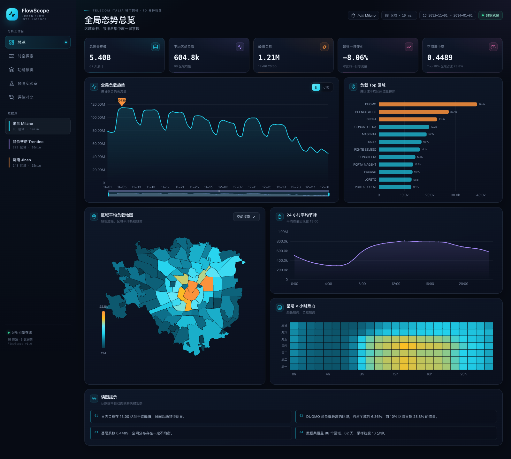
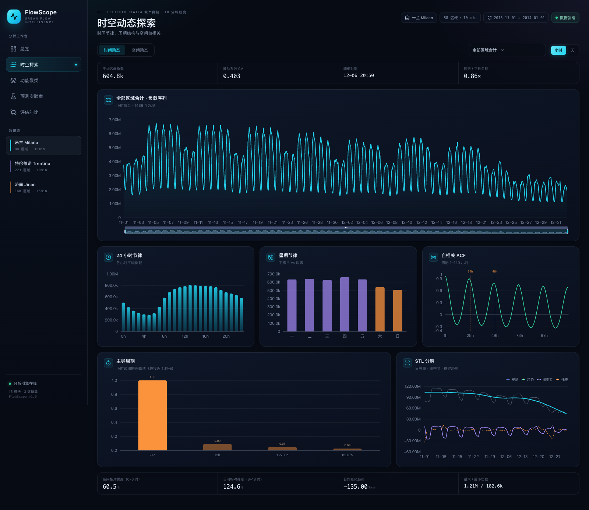
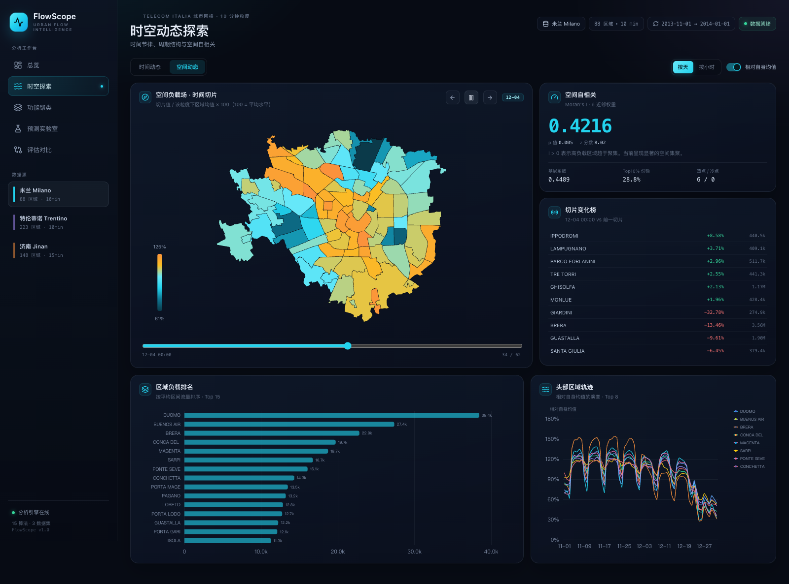
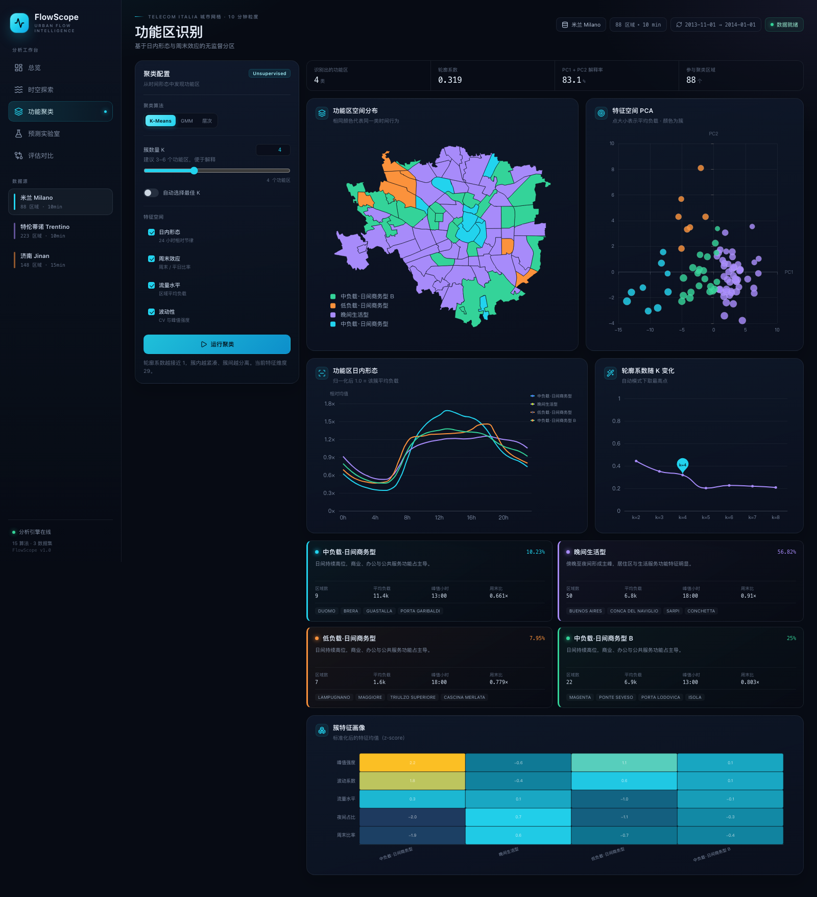
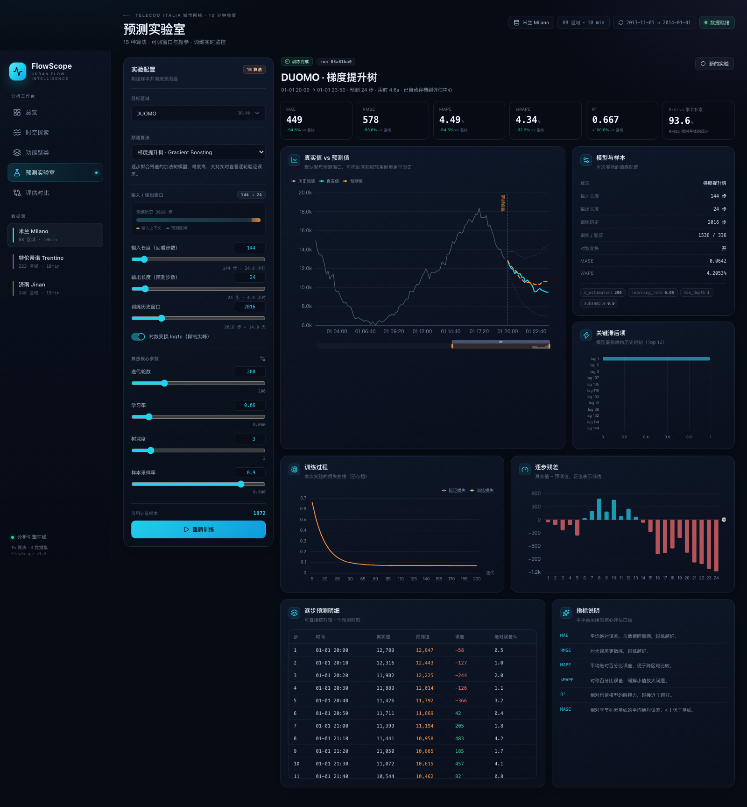
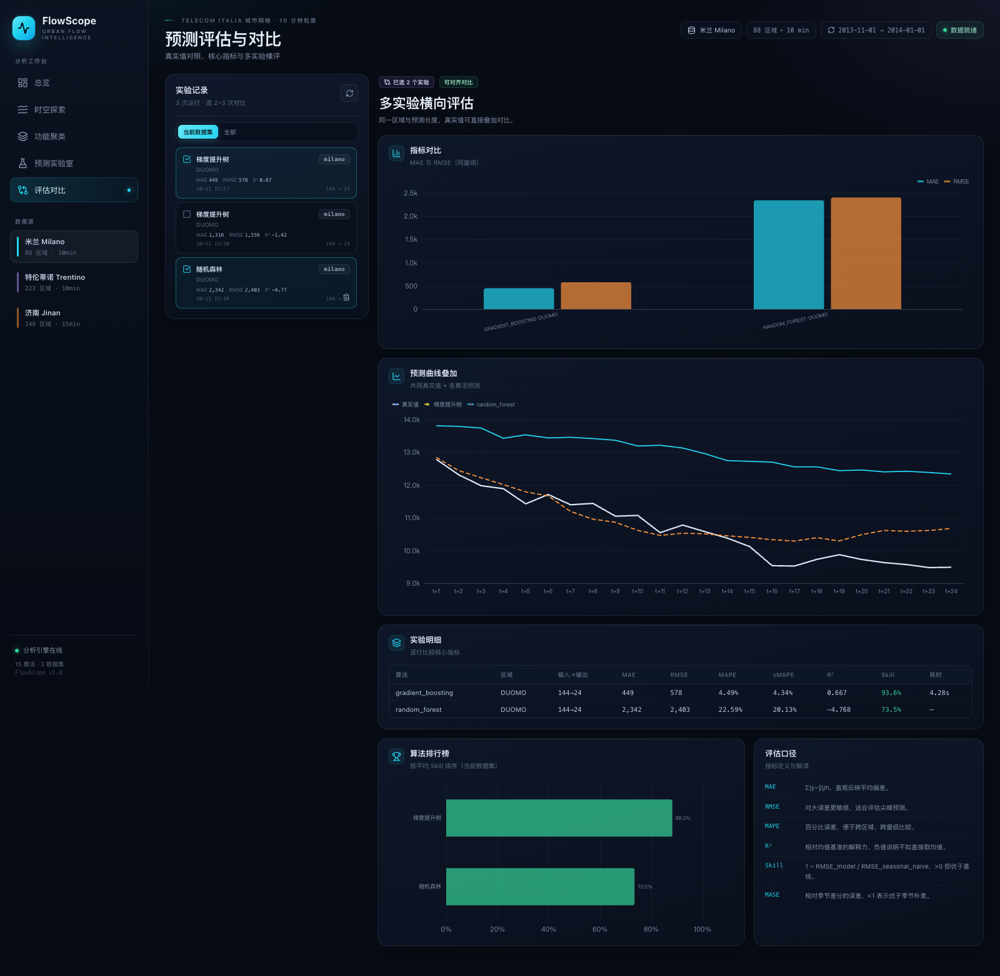

# FlowScope · 城市流量智能分析平台

面向区域级流量数据的本地 Web 应用：从**时空探索**、**功能区聚类**，到**可调窗口的多算法预测**与**真实值评估对比**，一条链路完成。

数据来自 `data.7z` 中的三套区域流量：

| 数据集 | 区域数 | 时间范围 | 粒度 | 说明 |
| --- | ---: | --- | --- | --- |
| 米兰 Milano | 88 | 2013-11-01 → 2014-01-01 | 10 min | Telecom Italia 城市 NIL 网格网络流量 |
| 特伦蒂诺 Trentino | 223 | 2013-11-01 → 2014-01-01 | 10 min | 市镇级网络流量 |
| 济南 Jinan | 148 | 2024-07-28 → 2024-08-25 | 15 min | 4G 下行流量（字节） |



---

## 1. 快速启动

```bash
cd /Users/eightfy/Projects/aifinal
./run.sh
```

打开 **http://127.0.0.1:8000**。API 文档在 `/docs`。

`run.sh` 会自动完成：创建 `.venv` → 安装后端依赖 → 预处理数据（如缺失）→ 构建前端（如缺失）→ 启动 FastAPI。
首次启动约 1–3 分钟，之后为秒级。

环境：macOS / Python 3.12+ / Node 20+。当前已验证 Python 3.14 + Node 26。

### 手动启动

```bash
# 后端
.venv/bin/uvicorn backend.app.main:app --host 127.0.0.1 --port 8000

# 前端开发模式（可选）
cd frontend && npm run dev   # http://127.0.0.1:5173，自动代理 /api
```

### 重新准备数据

原始 CSV/GeoJSON 已解压在 `data/`。若需要重建预处理产物：

```bash
.venv/bin/python scripts/prepare_data.py
```

产物：`prepared/{milano,trentino,jinan}.npz`、同名 `.geojson`、`datasets.json`。

---

## 2. 五个核心模块

### ① 探索性分析：时间与空间动态

- **时间动态**：小时/日聚合序列、24 小时节律、星期节律、星期 × 小时热力图、ACF 自相关、周期图峰值、STL 趋势/周季节分解、夜间/日间相对强度与趋势斜率。
- **空间动态**：GeoJSON 区域地图、时间切片滑杆 + 播放、按天/按小时切换、相对自身均值指数、Moran's I 空间自相关（6 近邻 + 199 次置换检验）、基尼系数、热点/冷点、当前切片变化榜、Top 区域轨迹。
- 支持任意区域下钻；点击地图区域可直接跳转到该区域的时间动态。




### ② 功能区聚类

- 特征空间：24 小时归一化形态、周末比率、夜间占比、流量水平、CV、峰值强度，可逐项开关。
- 算法：K-Means / Gaussian Mixture / 层次聚类；K 可手动指定或按轮廓系数自动选择。
- 输出：功能区地图、PCA 特征空间、轮廓系数曲线、簇平均日内形态、簇画像热力图、自动命名与功能解释、代表区域。
- 自动命名示例：`通勤双峰型`、`晚间生活型`、`低负载·日间商务型`、`周末休闲型`。



### ③ 预测数据构建面板

- 目标区域：全量区域可搜索选择。
- **输入长度**（回看步数）与 **输出长度**（预测步数）均可用滑杆/数字框人工设定；同步显示换算后的小时数。
- **训练历史窗口**独立可调；实时显示可用训练样本数。
- 可选 `log1p` 变换抑制流量尖峰；展示输入上下文与预测区间示意条。

### ④ 预测算法面板：15 种算法 + 实时训练监控

| 类别 | 算法 | 核心可调参数 |
| --- | --- | --- |
| 基线 | 朴素、季节朴素、移动平均 | 季节周期、平滑窗口 |
| 统计 | 指数平滑、Holt-Winters、SARIMA | α；趋势/季节/阻尼；p,d,q,P,D,Q,m,max_iter |
| 机器学习 | 岭回归 AR、Lasso AR、KNN、随机森林、极端随机树、梯度提升树、直方图提升树、SVR | α；K/权重；树数/深度/叶节点；学习率/采样率；C/ε/γ |
| 深度学习 | 多层感知机 MLP | 隐藏层、L2、学习率、最大轮数、早停耐心 |

训练任务在后台线程执行，**每 650 ms 轮询**阶段、进度、日志与学习曲线：

- 随机森林 / 极端随机树：按树数量增量训练，逐批回报验证损失。
- 梯度提升树：warm-start 分块提升，逐轮回报。
- MLP：逐 epoch 训练 + 验证损失 + 早停。
- 统计模型：按阶段回报拟合并给出残差信息。
- 训练完成后自动写入 SQLite 实验档案，并计算指标与近似 90% 区间。



### ⑤ 评估与对比

- 每个实验自动保存：配置、真实/预测序列、逐步误差、预测区间、训练曲线、指标。
- 单实验：MAE、RMSE、MAPE、sMAPE、R²、Skill、MASE、WAPE，真实值 vs 预测值、逐步残差、逐点明细。
- 多实验：勾选 2–3 个实验做指标对比；同一区域 + 同一输出长度时叠加预测曲线。
- 算法排行榜按平均 Skill 排序；支持删除实验。
- 基线统一为季节朴素（season = 一天的步数），`Skill = 1 − RMSE_model / RMSE_baseline`。



---

## 3. 预测与评估口径

- **多步策略**：递归多步（recursive multi-step）。每次预测值回填到输入窗口，直到生成 `output_len` 步。
- **稳定性保护**：递归过程中将中间预测裁剪到训练历史的 `[min, max]` 区间，避免树模型/神经网络反馈发散。
- **切分**：最后 `output_len` 个点作为测试集；测试集之前取 `history_len` 个点作为训练历史；训练样本按时间顺序取末尾约 18% 作为验证集（不随机打乱）。
- **标准化**：滞后特征与目标分别 `StandardScaler`；统计模型直接在序列上拟合。
- **区间**：验证残差标准差 × √h × 1.645，近似 90% 预测区间（非严格覆盖保证）。
- **指标**：
  - `MAE = mean(|y − ŷ|)`
  - `RMSE = sqrt(mean((y − ŷ)²))`
  - `MAPE = mean(|y − ŷ| / |y|) × 100`
  - `sMAPE = mean(2|y − ŷ| / (|y| + |ŷ|)) × 100`
  - `R² = 1 − SS_res / SS_tot`
  - `WAPE = Σ|y − ŷ| / Σ|y| × 100`
  - `MASE` 相对季节差分的平均绝对误差
  - `Skill = 1 − RMSE_model / RMSE_seasonal_naive`

> 注：米兰/特伦蒂诺的最后一个测试窗口正好跨元旦，节假日导致真实值系统性偏低；因此会出现 MAPE 较小但 R² 为负、或模型不如基线的正常现象。评估页保留真实结果，不做修饰。

---

## 4. 技术架构

```
React 19 + Vite + ECharts
        │  fetch /api
        ▼
FastAPI  ──  DataStore（NPZ + GeoJSON，内存）
   │         Analytics（时序/空间/Moran/STL）
   │         Clustering（sklearn）
   │         Forecast Engine（15 算法）
   │         JobManager（线程池 + 进度/曲线/日志）
   │         SQLite（实验档案）
        ▼
prepared/*.npz + *.geojson
```

- 地图使用 ECharts `map` + 本地 GeoJSON，**不依赖外部瓦片服务**，离线可用。
- 前端构建产物由 FastAPI 直接托管，单一 `127.0.0.1:8000` 入口。
- 任务并发上限 2；训练任务可取消。
- 实验档案：`backend/runs.db`（可用 `FLOWSCOPE_DB` 覆盖）。

### 目录

```
backend/
  app/
    main.py            API 路由 + 静态托管
    data_store.py      NPZ/GeoJSON 加载与聚合
    analytics.py       时序/空间分析
    clustering.py      特征构建 + 聚类
    jobs.py            后台任务、状态、曲线
    storage.py         SQLite 实验档案
    forecast/
      registry.py      15 种算法与参数元数据
      engine.py        训练/预测/区间
      metrics.py       评估指标
  requirements.txt
frontend/
  src/
    pages/             总览 / 时空探索 / 聚类 / 实验室 / 评估
    components/        EChart / GeoMap / 卡片 / 控件
scripts/prepare_data.py
prepared/              预处理产物
data/                  原始数据
run.sh
```

---

## 5. 主要 API

| 方法 | 路径 | 说明 |
| --- | --- | --- |
| GET | `/api/datasets` | 数据集元信息 |
| GET | `/api/datasets/{id}` | 区域列表与详情 |
| GET | `/api/datasets/{id}/geo` | 区域 GeoJSON |
| GET | `/api/datasets/{id}/overview` | 全局 KPI / 趋势 / 热力 |
| GET | `/api/datasets/{id}/temporal?region=&granularity=` | 时序、ACF、周期、STL |
| GET | `/api/datasets/{id}/spatial?granularity=` | 空间切片、Moran's I、变化榜 |
| POST | `/api/cluster` | 功能区聚类 |
| GET | `/api/algorithms?dataset=` | 算法与参数元数据 |
| POST | `/api/forecast` | 提交训练任务 → `jobId` |
| GET | `/api/jobs/{id}` | 进度、阶段、日志、学习曲线 |
| GET | `/api/jobs/{id}/result` | 预测与指标 |
| POST | `/api/jobs/{id}/cancel` | 取消任务 |
| GET | `/api/runs` | 实验列表 |
| GET | `/api/runs/{id}` | 单实验完整结果 |
| DELETE | `/api/runs/{id}` | 删除实验 |

---

## 6. 已知边界

- 面向本地单用户演示，未做账号体系与多租户隔离。
- 30 秒级实时流接入未包含；当前为离线批量数据的交互式分析。
- SARIMA 的季节项在 144/96 周期下会明显变慢，面板默认关闭季节项，可按需开启。
- 预测区间为残差近似，不是经校准的共形区间。
- 数据单位保持原始口径：济南为 Bytes，米兰/特伦蒂诺为原始流量单位。

---

## 7. 在线部署

- 前端（GitHub Pages）：https://eightfy.github.io/flowscope/
- 后端 API（Render）：https://flowscope-api-eightfy.onrender.com
- 源码仓库：https://github.com/eightfy/flowscope

### 前端

`.github/workflows/pages.yml` 在 `main` 分支推送时构建 `frontend/dist` 并部署到 GitHub Pages。构建时读取仓库变量 `VITE_API_URL`，写入前端 API 地址。

```bash
# 更换后端地址后重新部署
gh variable set VITE_API_URL --repo eightfy/flowscope --body https://<api-host>
gh workflow run pages.yml --repo eightfy/flowscope
```

Vite 使用 `base: './'`，因此项目页可以部署在任意子路径下；前端使用 hash 路由，不需要额外的 404 重写。

### 后端

`Dockerfile` 以 `python:3.12-slim` 安装依赖，复制 `backend/` 与 `prepared/`，启动 `uvicorn`。`render.yaml` 定义免费 Docker Web Service。

1. 打开 https://render.com/deploy?repo=https://github.com/eightfy/flowscope
2. 用 GitHub 登录并确认 Blueprint
3. 等待健康检查 `/api/health` 通过
4. 把服务 URL 写入 GitHub 变量 `VITE_API_URL`，重新运行 Pages workflow

Render 免费实例在空闲后会休眠，首次请求需要几十秒冷启动；训练任务受免费 CPU 限制，复杂模型会比本地慢。
